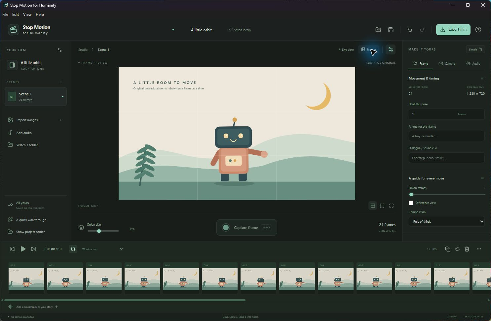
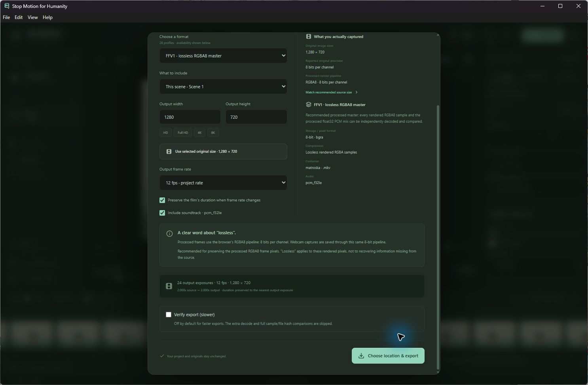

# Stop Motion for Humanity

### Your imagination. A camera. A whole film studio. Free.

Bring clay, paper, LEGO, drawings and everyday objects to life. Capture a tiny
movement, line it up with onion skin, find the rhythm, add sound and send your
story into the world.

**A free, open-source desktop studio for Windows and Mac, created by
[Taylor Kalin](https://www.taylorkalin.com/).** No account. No subscription.
No paid export tier. Your footage stays on your computer.

**[Download Windows x64](https://github.com/Teylersf/stop-motion-for-humanity/releases/download/v0.1.0-beta.1/StopMotionForHumanity-0.1.0-beta.1-win-x64.exe)**
· **[Download Apple Silicon Mac](https://github.com/Teylersf/stop-motion-for-humanity/releases/download/v0.1.0-beta.1/StopMotionForHumanity-0.1.0-beta.1-mac-arm64.dmg)**
· [Release notes, checksums and complete source](https://github.com/Teylersf/stop-motion-for-humanity/releases/tag/v0.1.0-beta.1)

The first beta is here. Windows installs per user. The Mac app requires macOS 14
or newer: open the DMG and drag the app into Applications. Windows is unsigned;
Mac is ad hoc signed and not Apple notarized. See the
[tested workflows and exact limits](docs/VALIDATION.md).



## Small movements. Serious filmmaking tools.

Start with a webcam and the Space bar. Grow into scenes, detailed timing,
sound design, reversible cleanup and professional post-production handoff.

| Make the next move | Shape the whole story |
| --- | --- |
| Named camera selector, actual capture resolution and capability-aware controls | Scenes, a virtualized frame timeline, frame holds and a dope sheet |
| Multi-frame onion skin, difference, split and blink comparisons | Insert, replace, reorder, duplicate, reverse, undo and redo |
| Pinned references, grids and aspect guides | Notes, titles, crop, rotation, flips and color adjustments |
| Single capture, countdown and interval capture | Chroma key, clean-plate restoration and separate drawing/eraser strokes |
| Import photographs or watch a tethering folder | Import or record sound, waveforms, cues, gain and fades |
| Large capture/play controls and keyboard shortcuts | Portable projects, autosave and recovery backups |

The built-in **original paper-robot animation** lets you try editing and exporting
before connecting a camera. A short walkthrough gets a first-time animator from
an empty project to a finished little film.

## From a shareable MP4 to a film-production image sequence

**28 export profiles**, with recommendations based on the images you actually
captured. Choose delivery video, a lossless rendered master, an editing
intermediate, broadcast media, a numbered image sequence or an original-project archive.

| Workflow | Available profiles |
| --- | --- |
| Lossless masters | FFV1 RGBA8, FFV1 RGB16, uncompressed RGB16 NUT, reversible JPEG 2000 MOV |
| Sharing and delivery | H.264/AVC MP4, 10-bit HEVC/H.265 MP4, 10-bit AV1 MKV, VP9/AV1 WebM, GIF |
| Apple editing workflows | ProRes Proxy, 422 LT, 422, 422 HQ, 4444 and 4444 XQ |
| Editorial and broadcast | DNxHR HQX, DNxHR 444, DNxHD, MXF OP1a DNxHR HQX, MXF MPEG-2 4:2:2 50 Mb/s |
| Other production handoffs | CineForm RGB12, PNG RGBA8, PNG RGB16, TIFF RGB16, DPX RGB16, linear float32 OpenEXR |
| NVIDIA hardware | HEVC codec-lossless P010, when a compatible GPU and driver initialize successfully |
| Keep everything | Originals ZIP: all scenes, original images/audio, project file and manifests; reopen it to continue editing |

HD, Full HD, 4K and **UHD 8K (7680 × 4320)** presets are built in. Custom sizes
are checked against the selected codec. Broadcast profiles offer legal raster/rate
conforms; GIF and fixed broadcast formats keep their actual format limits.
Changing export frame rate preserves animation duration by default through rounded
frame holds, without inventing intermediate motion.

**Fast export is the default.** `Verify export (slower)` starts unchecked.
Enable it for an independent decode and the relevant frame, sample or archive
integrity comparisons. Ordinary exports finish after the encoder and file save
complete. Only exports that run the extra checks are labeled verified.



### Choose quality with your eyes open

- **Best rendered lossless master:** FFV1 RGBA8 retains the renderer's actual RGBA samples.
- **Easiest to share:** H.264 MP4 produces a smaller, widely playable, lossy movie.
- **Best preservation of higher-depth sources:** Originals retains the stored files byte for byte.

The effects pipeline processes **RGBA8**. A 10/12/16-bit or float export is a valid
compatibility conversion from those rendered samples; it cannot recover detail or
precision that capture and rendering did not supply. ProRes, DNx and CineForm are
editing intermediates, not mathematically lossless profiles. NVIDIA's codec-lossless
mode preserves its converted P010 target, not the original RGB samples.

The export window shows original sizes and known bit depth, explains scaling and
conversion, and keeps professional formats selectable. Read the
[format and color reference](docs/FORMAT_SUPPORT.md) for the exact contract.

## Use the camera you already have

Connect a built-in camera, USB webcam, compatible capture card, OBS virtual camera
or professional camera that your operating system exposes as a webcam. Select it
by name, request a resolution and see the dimensions it actually delivers. The app
remembers your device and capture preferences without opening a camera automatically.

A USB-connected DSLR is not automatically a webcam. Camera mode, vendor utility,
driver, permissions and available controls determine what works. Direct proprietary
PTP shutter/RAW control, DMX and motion-control hardware are not included in this beta.
For high-resolution still photography, use your camera's tethering software and
import or watch its image folder.

**Physical Windows capture tested:** an EMEET SmartCam C960 4K negotiated
3840 × 2160 at 30 fps and saved an independently checked native 4K PNG.
See [camera support](docs/CAMERAS.md) and [validation evidence](docs/VALIDATION.md)
for the precise scope of each platform's checks.

## Your film belongs to you

Projects are ordinary folders with a readable project document and original
assets. Cleanup, color, framing, timing and titles are reversible edits. Removing a
timeline frame does not overwrite the photograph. Portable Originals archives keep
the project and its media together for another machine or another day.

No cloud upload is required. No advertising, analytics service, remote font or
Vercel media relay is part of the application.

## Learn, build and contribute

- [User guide and shortcuts](docs/USER_GUIDE.md)
- [Cameras and troubleshooting](docs/CAMERAS.md)
- [All export formats and precision](docs/FORMAT_SUPPORT.md)
- [Test results and their limits](docs/VALIDATION.md)
- [Architecture](docs/ARCHITECTURE.md)
- [Feature research and dated animator wishlist](docs/RESEARCH.md)
- [Report a bug or suggest an improvement](https://github.com/Teylersf/stop-motion-for-humanity/issues)

Node.js 22.12 or newer is required to build from source:

```sh
npm ci
npm run build
npm start
```

Native movie encoding requires the platform media payload under
`resources/media/<platform>-<arch>/`. Packaged releases bundle the runtime;
end users do not need Node, Python or a separately installed FFmpeg. Native build
recipes, dependency notices, source hashes and matching corresponding-source
archives accompany the media distribution.

The Mac release command uses the audited packaging wrapper to retain the exact
signed media tools and enforce the macOS 14 minimum. See the
[Mac build and release guide](scripts/mac-release/README.md) and
[Windows native media recipe](scripts/build-windows-static-media.sh).

```sh
npm test
npm run dist:win
npm run dist:mac
```

Application code is [GPL-3.0-or-later](LICENSE). Third-party components retain
their own licenses; see [NOTICE](NOTICE.md). This is an independent project,
not an endorsement by any camera or codec vendor.

**Made by Taylor Kalin. Free for humanity. Go make something wonderful.**
